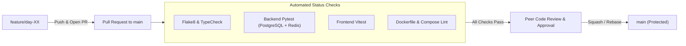

# 🛡️ GitHub Branch Protection & CI Status Check Policy

This document defines the enterprise Branch Protection rules and required automated CI status checks enforced on the `main` branch to maintain code quality, security, and stability.

---

## 🎯 Objectives
* Prevent direct pushes to production (`main`).
* Ensure all code is validated via automated testing (Pytest, Vitest, linting, Docker build) before merging.
* Mandate peer code reviews for all pull requests.
* Prevent regression bugs, broken builds, and unauthorized changes.

---

## ⚙️ Branch Protection Configuration Specification

To apply these rules in GitHub:
1. Navigate to **Repository Settings** $\rightarrow$ **Branches**.
2. Under **Branch protection rules**, click **Add branch protection rule**.
3. Set **Branch name pattern**: `main`.

### 1. Require a Pull Request Before Merging
* ✅ **Require a pull request before merging**
  * Required approvals: **1**
  * ✅ **Dismiss stale pull request approvals when new commits are pushed**
  * ✅ **Require review from Code Owners** (optional based on team structure)

### 2. Require Status Checks to Pass Before Merging
* ✅ **Require status checks to pass before merging**
* ✅ **Require branches to be up to date before merging** (ensures testing against latest `main`)
* **Mandatory Required Status Checks**:
  1. `Backend Pytest & Linting Suite` (`backend-test` job in `.github/workflows/day23-devops-ci.yml`)
  2. `Frontend Vitest & Build Validation` (`frontend-test` job in `.github/workflows/day23-devops-ci.yml`)
  3. `Dockerfile Lint & Compose Validation` (`docker-validate` job in `.github/workflows/day23-devops-ci.yml`)

### 3. Conversation & History Integrity
* ✅ **Require conversation resolution before merging** (all PR comments must be resolved)
* ✅ **Require signed commits** (cryptographic verification via GPG/SSH)
* ✅ **Require linear history** (prevents merge commit clutter; enforces Rebase or Squash merges)

### 4. Administrative Controls
* ✅ **Do not allow bypassing the above settings** (Enforce rules on repository administrators)
* ❌ **Allow force pushes**: `Disabled` (prevents history rewrites on `main`)
* ❌ **Allow deletions**: `Disabled` (prevents accidental branch removal)

---

## 🔄 Recommended Pull Request & Merge Workflow



1. **Create Feature Branch**:
   ```bash
   git checkout -b feature/my-feature
   ```
2. **Push & Open Pull Request**:
   ```bash
   git push origin feature/my-feature
   ```
3. **Automated CI Validation**:
   GitHub Actions automatically triggers `day23-devops-ci.yml`. Status badges show:
   * `Backend Pytest & Linting Suite` - **Passed**
   * `Frontend Vitest & Build Validation` - **Passed**
   * `Dockerfile Lint & Compose Validation` - **Passed**
4. **Merge**: Once checks are green and approved, merge via **Squash and Merge**.
