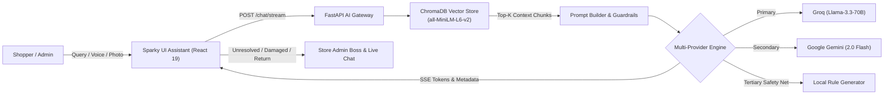

# Day 20 — AI Shopping Concierge with ChromaDB Vector RAG, Multi-Provider LLMs & SSE Streaming

<p align="left">
  
  
  
  
  
  
  
  
</p>

---

## 🎯 Overview & Objectives

**Day 20** implements **Sparky AI Concierge** — an enterprise-grade, retrieval-augmented shopping and customer support assistant seamlessly integrated across the full-stack e-commerce architecture. 

It pairs local vector search with high-throughput multi-provider LLMs, Server-Sent Events (SSE) token streaming, real-time citation cards, voice STT/TTS synthesis, and automated customer support exception handling.



---

## 🧠 1. Vector Store & Semantic Embeddings (ChromaDB)

### 📐 Embedding Model: `all-MiniLM-L6-v2`
* **Architecture:** Sentence-Transformers BERT-based dense bi-encoder.
* **Vector Dimensionality:** **384 dimensions**.
* **Metric:** Cosine Similarity (`"hnsw:space": "cosine"`).
* **Storage:** Persistent ChromaDB storage under `backend/chroma_db` with in-memory fallback.

### 📦 Document Chunking & Indexing (`core/vector_store.py`)
Products from PostgreSQL are structured into dense retrieval chunks:
```text
Product ID: {id}
Title: {title}
Category: {category}
Price: ${price}
Stock: {stock} units available
Description: {description}
```
* **Endpoint:** `POST /api/v1/ai/index-catalog` triggers automated chunking and vector indexing.
* **Semantic Top-K Search:** Queries are embedded into 384-d vectors to retrieve the top 4 relevant products with similarity distance scores, filtering out synthetic test fixtures.

---

## ⚡ 2. Multi-Provider LLM Architecture & Resilient Fallbacks (`core/ai_service.py`)

1. **Primary Provider (Ultra-Fast LPU):**
   * **Groq** (`llama-3.3-70b-versatile` / `llama-3.1-8b-instant`).
   * Sub-second time-to-first-token (TTFT) for snappy shopper conversational interactions.
2. **Secondary Provider (Deep Context):**
   * **Google Gemini** (`gemini-2.0-flash` / `gemini-1.5-flash`).
   * High-context window fallback when Groq experiences quota limits.
3. **Tertiary Safety Net (Zero-Downtime Offline Engine):**
   * **Local Intelligent RAG Generator**.
   * Provides 100% uptime even if external APIs or internet access are unavailable.

---

## 📡 3. Server-Sent Events (SSE) Streaming (`routers/ai_chat.py`)

* **Endpoint:** `POST /api/v1/ai/chat/stream` returns a continuous `text/event-stream`:
  * `event: metadata` — Emits structured JSON containing referenced catalog items, real-time pricing, stock status, and citation badges.
  * `event: provider` — Emits active AI model (`Groq & Llama-3.3-70B`, `Google Gemini 2.0 Flash`, or `Local RAG Intelligence`).
  * `event: token` — Emits incremental token chunks for real-time word-by-word UI rendering.
  * `event: done` — Signals completion of the response stream.

---

## 🛡️ 4. Customer Support Exception Handling & Concise Formatting

Sparky is explicitly trained to understand query intent and reply in **concise, turn-by-turn messages with interactive action buttons** (no bulky paragraphs):

| Support Scenario | Conversational Behavior & Prompt Directive | Interactive Action in UI |
| :--- | :--- | :--- |
| **Product Inquiry** | Answers specifically about the requested item (specs, price, stock). | Renders clean product card with direct `+ Cart` button. |
| **Generic Complaint** | Responds with empathy: *"We are sorry for the inconvenience! Could you please share more details about the issue so we can help you right away?"* | Logs feedback ticket to `rmart_support_tickets`. |
| **Return Request** | Asks for return reason first; upon reason selection, registers return pickup with invoice guidelines and re-order option. | Clickable reason chips + return item card with `🔄 Place Same Order Again (+ Cart)`. |
| **Not Received Order** | Apologizes for delay: *"We will talk to our Admin Boss about this right away to investigate your shipment immediately. 🚨"* | Logs urgent alert to `rmart_admin_notifications` + `👨‍💼 Talk to Admin on Live Chat` button. |
| **Damaged Product** | Prompts customer to upload photos of damage; verifies validity and approves 100% full refund. | `📸 Upload Photos of Damaged Item` button + refund payout alert. |
| **Off-Topic / Jokes** | Politely refuses jokes/unrelated topics: *"Apologise, I only can solve queries regarding our website!"* | Highlights trending products and active coupons (`FLASH50`, `FREESHIP`). |
| **Admin Handover** | Triggered on *"Problem not resolved"* or *"Talk to admin"*. Briefs Admin Boss on Sparky's attempt. | One-click direct transfer to Live Human Support Chat. |

---

## 🎙️ 5. Voice Input & Speech Synthesis

* **Speech Recognition (STT):** Web Speech API integration (`SpeechRecognition` / `webkitSpeechRecognition`) with pulsing microphone indicator.
* **Natural Speech Synthesis (TTS):** Human-like pitch (1.0) and articulate cadence (0.98), auto-canceling speech on chat modal close or reset.

---

## 🧪 6. Automated Verification Suite

### Backend Pytest Suite (44 Tests Passed)
```bash
cd backend
..\..\venv\Scripts\python.exe -m pytest tests/
```
* `test_ai_health_endpoint`: Validates provider health and ChromaDB connectivity.
* `test_index_catalog_endpoint`: Validates chunking and vector storage.
* `test_vector_store_semantic_search`: Validates cosine similarity product retrieval.
* `test_out_of_stock_directive_and_grounding`: Verifies Admin Boss restock alert directive.
* `test_off_topic_guardrail_rejection`: Verifies refusal of jokes and off-topic queries.
* `test_sse_streaming_endpoint`: Verifies SSE metadata, provider, and token streaming.

### Frontend Vitest Suite (67 Tests Passed)
```bash
npm test -- --run
```
* Verifies hover-only Sparky speech bubble (`sparkyyy here !` for shoppers, `bosss` for admin).
* Verifies pitch-dark background backdrop on chat modal activation.
* Verifies damaged product photo upload, validity check, and 100% refund approval.
* Verifies order not received immediate Admin Boss alert.
* Verifies return reason prompt, pickup scheduling with invoice packing, and 1-click re-order button.
* Verifies thorough Log Out token purge.
