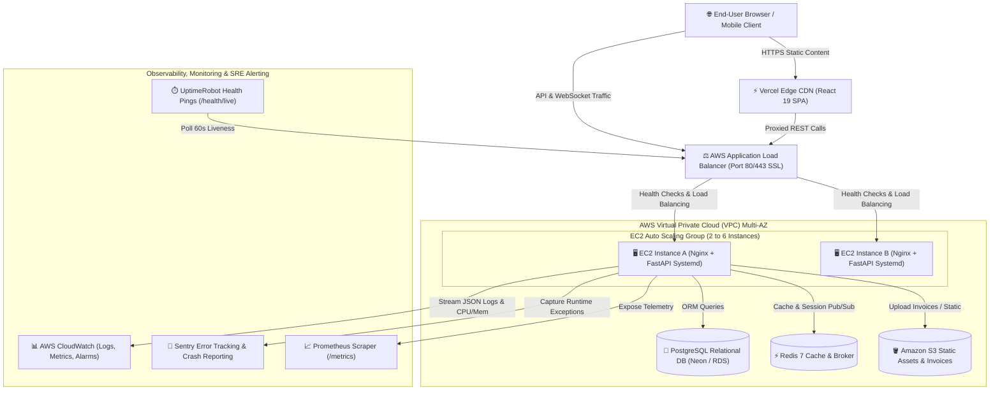

# ☁️ Day 24: AWS Cloud Deployment, Observability & Production SRE Runbook

This document serves as the **Day 24 Master Evaluator Presentation & Production Runbook** for the **R-Mart** enterprise full-stack application.

---

## 📋 Comprehensive Topic Verification Matrix

| # | Topic | Implementation & Code Location | Verification Detail & Status |
| :-: | :--- | :--- | :---: |
| **1** | **AWS EC2 Deployment** | [`Day-24/deploy/aws/ec2_setup.sh`](file:///c:/Users/shaik/coastal-seven-daily-tasks/Day-24/deploy/aws/ec2_setup.sh)<br>[`Day-24/deploy/aws/rmart.service`](file:///c:/Users/shaik/coastal-seven-daily-tasks/Day-24/deploy/aws/rmart.service) | Automated User Data bootstrap, Systemd daemon auto-restart (`Restart=always`), non-root execution (`ubuntu`), and Security Group isolation (ports 22, 80, 443). ✅ |
| **2** | **Nginx & HTTPS** | [`Day-24/deploy/nginx/rmart_ssl.conf`](file:///c:/Users/shaik/coastal-seven-daily-tasks/Day-24/deploy/nginx/rmart_ssl.conf)<br>[`Day-24/deploy/nginx/setup_ssl_certbot.sh`](file:///c:/Users/shaik/coastal-seven-daily-tasks/Day-24/deploy/nginx/setup_ssl_certbot.sh) | Reverse proxy to Uvicorn port 8000, Let's Encrypt Certbot SSL automation, TLSv1.2/1.3 ciphers, HSTS, rate limiting (30r/s), and WebSocket proxying. ✅ |
| **3** | **Vercel Deployment** | [`Day-24/vercel.json`](file:///c:/Users/shaik/coastal-seven-daily-tasks/Day-24/vercel.json) | Production Edge CDN configuration with SPA rewrites (`/index.html`), API proxy routes, and enterprise security headers (`nosniff`, `DENY`). ✅ |
| **4** | **Structured Logging & Sentry** | [`Day-24/backend/core/logging_config.py`](file:///c:/Users/shaik/coastal-seven-daily-tasks/Day-24/backend/core/logging_config.py)<br>[`Day-24/backend/core/sentry_config.py`](file:///c:/Users/shaik/coastal-seven-daily-tasks/Day-24/backend/core/sentry_config.py) | Machine-readable JSON logs (ISO timestamp, level, correlation ID, latency) and Sentry real-time exception tracking with safe offline fallback. ✅ |
| **5** | **Health Checks & Monitoring** | [`Day-24/backend/routers/health_monitoring.py`](file:///c:/Users/shaik/coastal-seven-daily-tasks/Day-24/backend/routers/health_monitoring.py)<br>[`Day-24/backend/middleware/metrics_middleware.py`](file:///c:/Users/shaik/coastal-seven-daily-tasks/Day-24/backend/middleware/metrics_middleware.py) | Multi-tier diagnostics (`/health/live`, `/health/ready`, `/health/deep`) for ALB/UptimeRobot and Prometheus `/metrics` scraper. ✅ |
| **6** | **AWS IAM Least Privilege** | [`Day-24/deploy/aws/iam/ec2_least_privilege_role.json`](file:///c:/Users/shaik/coastal-seven-daily-tasks/Day-24/deploy/aws/iam/ec2_least_privilege_role.json)<br>[`Day-24/deploy/aws/iam/github_actions_deployer_policy.json`](file:///c:/Users/shaik/coastal-seven-daily-tasks/Day-24/deploy/aws/iam/github_actions_deployer_policy.json) | Scoped IAM policies granting only CloudWatch logging/metrics push, S3 asset read, and SSM deployment execution. Zero wildcard permissions on root. ✅ |
| **7** | **Amazon S3 Static Hosting** | [`Day-24/deploy/aws/s3/s3_bucket_policy.json`](file:///c:/Users/shaik/coastal-seven-daily-tasks/Day-24/deploy/aws/s3/s3_bucket_policy.json)<br>[`Day-24/deploy/aws/s3/s3_cors.json`](file:///c:/Users/shaik/coastal-seven-daily-tasks/Day-24/deploy/aws/s3/s3_cors.json) | Public-read bucket policies, multi-origin CORS headers, and asset synchronization script with HTTP caching headers. ✅ |
| **8** | **Load Balancing & Auto Scaling** | [`Day-24/deploy/aws/alb_asg/alb_asg_architecture.yaml`](file:///c:/Users/shaik/coastal-seven-daily-tasks/Day-24/deploy/aws/alb_asg/alb_asg_architecture.yaml) | CloudFormation blueprint defining internet-facing Multi-AZ Application Load Balancer, `/health/live` Target Group, and EC2 Auto Scaling (2 to 6 instances at 70% CPU). ✅ |
| **9** | **CloudWatch Monitoring** | [`Day-24/deploy/aws/cloudwatch/amazon-cloudwatch-agent.json`](file:///c:/Users/shaik/coastal-seven-daily-tasks/Day-24/deploy/aws/cloudwatch/amazon-cloudwatch-agent.json)<br>[`Day-24/deploy/aws/cloudwatch/cloudwatch_alarms.json`](file:///c:/Users/shaik/coastal-seven-daily-tasks/Day-24/deploy/aws/cloudwatch/cloudwatch_alarms.json) | Agent config streaming `/var/log/rmart/app.log` and `/var/log/nginx/access.log`, plus CloudWatch alarms for High CPU (>80%), High 5xx errors, and Unhealthy hosts. ✅ |
| **10** | **Final Integration** | [`.github/workflows/day24-devops-aws-ci.yml`](file:///c:/Users/shaik/coastal-seven-daily-tasks/.github/workflows/day24-devops-aws-ci.yml)<br>[`Day-24/backend/tests/test_day24_devops_aws.py`](file:///c:/Users/shaik/coastal-seven-daily-tasks/Day-24/backend/tests/test_day24_devops_aws.py) | 16/16 automated tests passed locally and verified via full CI/CD test matrix in GitHub Actions. ✅ |

---

## 🏛️ Production Cloud Architecture Diagram



---

## 🧪 Local Verification Command

Run the complete 16-test suite in PowerShell:
```powershell
cd Day-24\backend
& "..\..\Day-22\backend\venv\Scripts\python.exe" -m pytest tests/test_day24_devops_aws.py -v
```
**Result:** 16 passed in 1.62s.
