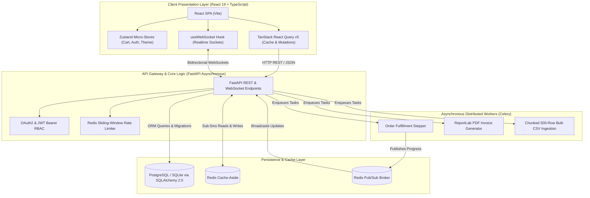

# Coastal Seven Daily Tasks — Enterprise Full-Stack E-Commerce Platform

<p align="center">
  
  
  
  
  
  
  
  
  
  
  
  
  
  
  
  
  
  
  
</p>

---

## 📖 Executive Summary

**Coastal Seven Daily Tasks** is a complete, production-grade enterprise full-stack software engineering curriculum tracking progress from **Day 01 through Day 22 (AI Focus Capstone)**. 

The repository demonstrates a scalable journey from core algorithmic Python scripting and relational database architecture to an asynchronous, distributed full-stack AI-enhanced E-Commerce platform (**R-Mart**) featuring **FastAPI**, **PostgreSQL (Neon)**, **Redis Cache & Pub/Sub**, **Celery Asynchronous Workers**, **ReportLab PDF Invoices**, **ChromaDB Dense Vectors**, **Multi-LLM RAG Streaming (Gemini + Groq)**, **React 19 + TypeScript**, **Zustand State Management**, **TanStack React Query v5**, **Bidirectional WebSockets**, **Responsible AI Cost Governance ($0.00 spend)**, and automated quality assurance across **Pytest**, **Vitest**, and **Playwright**.

---

## 🌐 Live Production Deployments

The Capstone application is deployed online and accessible at:

* 🌐 **Frontend Application:** [https://coastal-seven-daily-tasks.onrender.com](https://coastal-seven-daily-tasks.onrender.com)
* 🔌 **Backend REST API:** [https://e-commerce-backend-texz.onrender.com](https://e-commerce-backend-texz.onrender.com)
* 📖 **Interactive Swagger Docs:** [https://e-commerce-backend-texz.onrender.com/docs](https://e-commerce-backend-texz.onrender.com/docs)

---

## 🏗️ System Architecture & Data Flow



---

## 🛠️ Tools, Libraries & Frameworks Matrix

| Domain | Technology / Tool | Version | Purpose in Architecture |
| :--- | :--- | :--- | :--- |
| **Backend Framework** | **FastAPI** | `0.115+` | Asynchronous high-throughput RESTful API & WebSocket gateway |
| **ASGI Web Server** | **Uvicorn** | `0.30+` | ASGI web server with event loop and hot reloading |
| **Primary Language** | **Python** | `3.11+` | Core algorithmic and backend development |
| **Relational Database** | **PostgreSQL (Neon)** | Serverless | Cloud-native serverless relational database with pooling |
| **Local Database** | **SQLite** | `3.x` | Lightweight local and testing relational database engine |
| **ORM & Migrations** | **SQLAlchemy 2.0 & Alembic** | `2.0.30+` | Declarative models, relationship mapping, $N+1$ optimization, schema versioning |
| **Database Driver** | **psycopg / psycopg2** | `3.x` | High-performance PostgreSQL database adapter |
| **Cache & Pub/Sub** | **Redis** | `5.0+` | Cache-aside catalog storage, sliding-window rate limiters, WebSocket pub/sub |
| **Background Tasks** | **Celery** | `5.4+` | Distributed task queue handling bulk CSV imports, fulfillment, and invoices |
| **Document Generation** | **ReportLab** | `4.2+` | Programmatic PDF commercial invoice generation with itemized tables |
| **Image Processing** | **Pillow (PIL)** | `10.3+` | Asynchronous thumbnail downscaling (300x300 px) and format validation |
| **Frontend Framework** | **React** | `19.2+` | Modern component architecture and UI presentation |
| **Type System** | **TypeScript** | `5.x` | Strict type definitions, interfaces, and compiler validation |
| **Build Tool & HMR** | **Vite** | `8.3+` | Sub-second Hot Module Replacement and production bundling |
| **State Management** | **Zustand** | `5.0+` | Atomic client state micro-stores with local storage persistence |
| **Server State & Cache**| **TanStack React Query** | `v5` | Background query caching, optimistic mutations, infinite scroll |
| **Utility Styling** | **Tailwind CSS & PostCSS** | `4.3+` | Utility-first responsive styling and dark mode theming |
| **Form Management** | **React Hook Form & Zod** | `7.89+` / `3.25+` | High-performance uncontrolled form state and strict schema validation |
| **Icons & Drag-and-Drop**| **Lucide React & Dropzone**| `1.49+` / `20.1+` | Iconography and accessible drag-and-drop media ingestion |
| **Real-Time Sockets** | **WebSockets (Native & Starlette)**| Built-in | Bidirectional live order tracking, chat, and notification streams |
| **Unit & Integration Test**| **Pytest & Pytest-Asyncio** | `8.0+` | Backend automated test suites (21 Day-10 tests + 34 Day-18 tests) |
| **Component Testing** | **Vitest & RTL** | `5.0+` | Frontend unit/component testing with React Testing Library |
| **Network Mocking** | **MSW (Mock Service Worker)** | `2.x` | Offline declarative HTTP mocking for component isolation |
| **CI/CD Automation** | **GitHub Actions** | `v4` | Automated continuous integration test matrix across backend and frontend |
| **API Security & Limits**| **slowapi** | `0.1.10+` | Sliding-window IP rate limiting, brute-force mitigation, 429 Retry-After |
| **Response Compression** | **GZipMiddleware** | Built-in | Automatic HTTP payload compression (>1KB responses) |
| **Load Testing** | **Locust** | `2.46+` | Distributed 50-user concurrent load simulation and latency benchmarking |

---

### 📊 Master Progress & Architecture Tracker (Days 01–22)

> 💡 **Quick Revision & Interview Cheat Sheet**: Rapid technical review of each milestone's domain, technology stack, architectural purpose, and production status.

<table width="100%">
  <thead>
    <tr style="background-color: #f1f5f9;">
      <th align="center" width="10%">Day</th>
      <th align="left" width="15%">Domain</th>
      <th align="left" width="20%">Technology / Tool</th>
      <th align="center" width="10%">Version</th>
      <th align="left" width="35%">Purpose in Architecture</th>
      <th align="center" width="10%">Status</th>
    </tr>
  </thead>
  <tbody>
    <tr>
      <td align="center"><b>Day 01</b></td>
      <td><b>Backend API</b></td>
      <td>FastAPI, Pydantic, Uvicorn</td>
      <td align="center"><code>0.115+</code></td>
      <td>RESTful CRUD endpoints with automatic request schema validation, serialization, and Swagger UI docs.</td>
      <td align="center">✅ Completed</td>
    </tr>
    <tr>
      <td align="center"><b>Day 02</b></td>
      <td><b>Python Core</b></td>
      <td>Python 3, JSON, CSV</td>
      <td align="center"><code>3.11+</code></td>
      <td>Modular CLI Contact Book with persistent JSON file storage, CSV export, and algorithmic modulo/primality tests.</td>
      <td align="center">✅ Completed</td>
    </tr>
    <tr>
      <td align="center"><b>Day 03</b></td>
      <td><b>OOP Design</b></td>
      <td>Python OOP, ABC, Dunder Methods</td>
      <td align="center"><code>3.11+</code></td>
      <td>Defensive OOP banking system with abstract base contracts, encapsulation, properties, and polymorphic accounts.</td>
      <td align="center">✅ Completed</td>
    </tr>
    <tr>
      <td align="center"><b>Day 04</b></td>
      <td><b>Cloud Database</b></td>
      <td>Neon PostgreSQL, psycopg</td>
      <td align="center"><code>16 / 3.x</code></td>
      <td>Serverless cloud PostgreSQL with connection pooling, parameterized SQL queries, and Pytest fixtures.</td>
      <td align="center">✅ Completed</td>
    </tr>
    <tr>
      <td align="center"><b>Day 05</b></td>
      <td><b>ORM & Migrations</b></td>
      <td>SQLAlchemy 2.0, Alembic, SQLite</td>
      <td align="center"><code>2.0+ / 1.13+</code></td>
      <td>Declarative entity mappings, repository pattern for CRUD, and automated programmatic Alembic migrations.</td>
      <td align="center">✅ Completed</td>
    </tr>
    <tr>
      <td align="center"><b>Day 06</b></td>
      <td><b>Auth & Security</b></td>
      <td>JWT (PyJWT), Passlib, Bcrypt</td>
      <td align="center"><code>2.8+ / 4.1+</code></td>
      <td>Stateless auth with salted password hashing, JWT bearer tokens, and role-based route guards (admin/user).</td>
      <td align="center">✅ Completed</td>
    </tr>
    <tr>
      <td align="center"><b>Day 07</b></td>
      <td><b>Task REST API</b></td>
      <td>FastAPI, JWT, CORS Middleware</td>
      <td align="center"><code>0.115+</code></td>
      <td>Multi-tenant project & task API with foreign key owner constraints, task lifecycle transitions, and CORS.</td>
      <td align="center">✅ Completed</td>
    </tr>
    <tr>
      <td align="center"><b>Day 08</b></td>
      <td><b>Async & Caching</b></td>
      <td>Redis, Celery, asyncio.gather</td>
      <td align="center"><code>5.0+ / 5.4+</code></td>
      <td>Cache-aside architecture for sub-5ms read speeds, sliding-window rate limiters, and Celery report tasks.</td>
      <td align="center">✅ Completed</td>
    </tr>
    <tr>
      <td align="center"><b>Day 09</b></td>
      <td><b>File Pipelines</b></td>
      <td>Pillow (PIL), WebSockets, UploadFile</td>
      <td align="center"><code>10.3+</code></td>
      <td>File ingestion pipeline with MIME validation, asynchronous 300x300 thumbnail generation, and WebSocket alerts.</td>
      <td align="center">✅ Completed</td>
    </tr>
    <tr>
      <td align="center"><b>Day 10</b></td>
      <td><b>E-Commerce Engine</b></td>
      <td>FastAPI, PostgreSQL, Redis Pub/Sub</td>
      <td align="center"><code>0.115+ / 5.0+</code></td>
      <td>Core E-Commerce relational model, atomic cart item quantity stacking, inventory safety checks, and Pytests.</td>
      <td align="center">✅ Completed</td>
    </tr>
    <tr>
      <td align="center"><b>Day 11</b></td>
      <td><b>React Frontend</b></td>
      <td>React 19, Vite, React Router v6</td>
      <td align="center"><code>19.2+ / 8.3+</code></td>
      <td>Single-page client with declarative routing, Context API auth state, protected admin routes, and cart drawer.</td>
      <td align="center">✅ Completed</td>
    </tr>
    <tr>
      <td align="center"><b>Day 12</b></td>
      <td><b>Design & Forms</b></td>
      <td>Tailwind CSS, Shadcn/ui, Zod</td>
      <td align="center"><code>4.3+ / 3.25+</code></td>
      <td>Accessible dark-mode UI with high-performance uncontrolled form state, Zod validation, and checkout wizard.</td>
      <td align="center">✅ Completed</td>
    </tr>
    <tr>
      <td align="center"><b>Day 13</b></td>
      <td><b>Catalog & Admin</b></td>
      <td>React 19, Context API, Lucide React</td>
      <td align="center"><code>19.2+ / 1.49+</code></td>
      <td>Multi-facet product filtering, search, sorting, dedicated item detail view (/catalog/:id), and Admin Studio.</td>
      <td align="center">✅ Completed</td>
    </tr>
    <tr>
      <td align="center"><b>Day 14</b></td>
      <td><b>State & Query</b></td>
      <td>Zustand, TanStack React Query v5</td>
      <td align="center"><code>5.0+ / v5</code></td>
      <td>Atomic Zustand micro-stores and automated server query caching, background refetching, and optimistic mutations.</td>
      <td align="center">✅ Completed</td>
    </tr>
    <tr>
      <td align="center"><b>Day 15</b></td>
      <td><b>Strict QA & E2E</b></td>
      <td>TypeScript, Vitest, Playwright, MSW</td>
      <td align="center"><code>5.x / 5.0+</code></td>
      <td>Strict TypeScript interfaces, MSW offline network mocking, Vitest component tests, and Playwright E2E journeys.</td>
      <td align="center">✅ Completed</td>
    </tr>
    <tr>
      <td align="center"><b>Day 16</b></td>
      <td><b>Production Frontend</b></td>
      <td>Zustand Persistence, RTL, Zod</td>
      <td align="center"><code>5.0+ / 16.0+</code></td>
      <td>Persistent cart storage across browser refreshes, complete admin stock CRUD, and 40-test automated quality matrix.</td>
      <td align="center">✅ Completed</td>
    </tr>
    <tr>
      <td align="center"><b>Day 17</b></td>
      <td><b>Real-Time Sockets</b></td>
      <td>Native WebSockets, Redis Pub/Sub</td>
      <td align="center"><code>Built-in / 5.0+</code></td>
      <td>Bidirectional order-status push notifications, live delivery stepper, customer support chat, and reconnection backoff.</td>
      <td align="center">✅ Completed</td>
    </tr>
    <tr>
      <td align="center"><b>Day 18</b></td>
      <td><b>Background Jobs</b></td>
      <td>Celery, Redis, ReportLab, Pandas</td>
      <td align="center"><code>5.4+ / 4.2+</code></td>
      <td>Heavy workload offloading: chunked 500-row bulk CSV imports, PDF invoice generation, and status polling endpoints.</td>
      <td align="center">✅ Completed</td>
    </tr>
    <tr>
      <td align="center"><b>Day 19</b></td>
      <td><b>Security & Load</b></td>
      <td>slowapi, GZipMiddleware, Locust</td>
      <td align="center"><code>0.1.10+ / 2.46+</code></td>
      <td>API hardening with sliding-window rate limiting, GZip payload compression, and 50-user concurrent Locust load testing.</td>
      <td align="center">✅ Completed</td>
    </tr>
    <tr>
      <td align="center"><b>Day 20</b></td>
      <td><b>Vector RAG & AI</b></td>
      <td>ChromaDB, Gemini Flash, Groq, SSE</td>
      <td align="center"><code>0.6+ / 2.0+</code></td>
      <td>AI Shopping Concierge with dense vector retrieval (all-MiniLM-L6-v2), multi-LLM routing, and SSE token streaming.</td>
      <td align="center">✅ Completed</td>
    </tr>
    <tr>
      <td align="center"><b>Day 21</b></td>
      <td><b>Agent & Governance</b></td>
      <td>Groq (Llama-3.3-70B), Redis, Function Calling</td>
      <td align="center"><code>Cloud / 5.0+</code></td>
      <td>AI Copywriter studio, autonomous agent tool calling (stock, orders, coupons), moderation, and &lt;3ms Redis AI caching.</td>
      <td align="center">✅ Completed</td>
    </tr>
    <tr>
      <td align="center"><b>Day 22</b></td>
      <td><b>AI Capstone</b></td>
      <td>FastAPI, React 19, ChromaDB, Celery, Render</td>
      <td align="center"><code>Production</code></td>
      <td>Unified RAG streaming, semantic search, AI copywriter, WebSockets, and cost governance ($0.00 spend) on Render live.</td>
      <td align="center">★ Live Deployed</td>
    </tr>
  </tbody>
</table>


---

## 🌿 Day-to-Day Git Branch Mapping

Every milestone in this repository is isolated into its own cleanly structured feature branch:

| Milestone | Git Feature Branch | Switch Command |
| :--- | :--- | :--- |
| **Day 01** | `feature/day-01-python-fastapi` | `git checkout feature/day-01-python-fastapi` |
| **Day 02** | `feature/day-02-python-foundations` | `git checkout feature/day-02-python-foundations` |
| **Day 03** | `feature/day-03-oop-principles` | `git checkout feature/day-03-oop-principles` |
| **Day 04** | `feature/day-04-cli-task-manager` | `git checkout feature/day-04-cli-task-manager` |
| **Day 05** | `feature/day-05-fastapi-sqlalchemy` | `git checkout feature/day-05-fastapi-sqlalchemy` |
| **Day 06** | `feature/day-06-jwt-rbac` | `git checkout feature/day-06-jwt-rbac` |
| **Day 07** | `feature/day-07-task-mgmt-jwt-redis` | `git checkout feature/day-07-task-mgmt-jwt-redis` |
| **Day 08** | `feature/day-08-fastapi-redis-celery` | `git checkout feature/day-08-fastapi-redis-celery` |
| **Day 09** | `feature/day-09-file-processing-websockets` | `git checkout feature/day-09-file-processing-websockets` |
| **Day 10** | `feature/day-10-ecommerce-backend` | `git checkout feature/day-10-ecommerce-backend` |
| **Day 11** | `feature/day-11-react-frontend-integration` | `git checkout feature/day-11-react-frontend-integration` |
| **Day 12** | `feature/day-12-tailwind-shadcn-forms` | `git checkout feature/day-12-tailwind-shadcn-forms` |
| **Day 13** | `feature/day-13-ecommerce-frontend-part1` | `git checkout feature/day-13-ecommerce-frontend-part1` |
| **Day 14** | `feature/day-14-state-query-performance` | `git checkout feature/day-14-state-query-performance` |
| **Day 15** | `feature/day-15-typescript-testing` | `git checkout feature/day-15-typescript-testing` |
| **Day 16** | `feature/day-16-ecommerce-frontend-part2` | `git checkout feature/day-16-ecommerce-frontend-part2` |
| **Day 17** | `feature/day-17-fullstack-websockets-tracking` | `git checkout feature/day-17-fullstack-websockets-tracking` |
| **Day 18** | `feature/day-18` | `git checkout feature/day-18` |
| **Day 19** | `feature/day-19-security-performance-loadtest` | `git checkout feature/day-19-security-performance-loadtest` |
| **Day 20** | `feature/day-20-ai-rag-streaming` | `git checkout feature/day-20-ai-rag-streaming` |
| **Day 21** | `feature/day-21-ai-focus` | `git checkout feature/day-21-ai-focus` |
| **Day 22** | `feature/day-22-ai-focus-capstone` | `git checkout feature/day-22-ai-focus-capstone` |

---

## 📁 Repository Directory Structure

```text
coastal-seven-daily-tasks/
├── .github/workflows/ci.yml # Automated CI matrix (Days 10-16)
├── .gitignore              # Standardized Git exclusion rules
├── LICENSE                 # Project license
├── README.md               # Master curriculum documentation (This file)
├── requirements.txt        # Shared project Python dependencies
│
├── Day-01/                 # Python basics & FastAPI Student API
├── Day-02/                 # Algorithmic loops, data structures, Contact Book CLI
├── Day-03/                 # Object-Oriented Programming (OOP) in Python
├── Day-04/                 # Cloud Neon PostgreSQL & CLI Task Manager
├── Day-05/                 # SQLAlchemy 2.0 ORM, Alembic migrations & modular CRUD
├── Day-06/                 # JWT Authentication & Role-Based Access Control (RBAC)
├── Day-07/                 # Production Task Management API with JWT Auth
├── Day-08/                 # High-performance async FastAPI, Redis & Celery
├── Day-09/                 # File uploads, Pillow 300x300 thumbnails & WebSockets
├── Day-10/                 # E-Commerce backend, cart stacking, Redis & 21 Pytest tests
├── Day-11/                 # React SPA frontend, React Router v6 & Context API
├── Day-12/                 # Tailwind CSS, Shadcn/ui & Zod multi-step checkout
├── Day-13/                 # Catalog browsing, drawer navigation & Admin Studio
├── Day-14/                 # Zustand micro-stores, TanStack Query v5 & 3D Motion
├── Day-15/                 # TypeScript strict typing, Vitest & Playwright E2E
├── Day-16/                 # Frontend Part 2, Zustand cart & 40-test quality matrix
├── Day-17/                 # Full-stack real-time WebSockets, live tracking & chat
├── Day-18/                 # Celery async polling, ReportLab PDF, bulk CSV, 34 Pytests
├── Day-19/                 # API security, slowapi, OWASP, GZip, Locust load test, bundle splitting
├── Day-20/                 # AI shopping assistant, ChromaDB RAG, multi-provider LLMs, SSE streaming
├── Day-21/                 # AI copywriter studio, ChromaDB search, Redis cache & agent tools
└── Day-22/                 # Capstone: Full-stack RAG, semantic discovery, WebSockets & zero-cost governance
```

---

## 🚀 Quickstart & Execution Guide

### 1. Prerequisites
- **Python**: 3.11+
- **Node.js**: 20+
- **Redis Server**: Local or cloud instance (`redis://localhost:6379/0`)

### 2. Python Environment Setup
```bash
# Clone the repository
git clone https://github.com/RehanaG7/coastal-seven-daily-tasks.git
cd coastal-seven-daily-tasks

# Create and activate Python virtual environment
python -m venv venv
# Windows:
.\venv\Scripts\activate
# Linux/macOS:
source venv/bin/activate

# Install dependencies
pip install -r requirements.txt
```

### 3. Running Day-18 Full-Stack Platform

#### Terminal A: FastAPI Backend
```bash
cd Day-18/backend
uvicorn main:app --reload --port 8000
```
*Interactive Swagger UI: `http://127.0.0.1:8000/docs`*

#### Terminal B: Celery Worker
```bash
cd Day-18/backend
celery -A tasks.celery_app.celery_app worker --loglevel=info
```

#### Terminal C: React 19 Frontend
```bash
cd Day-18
npm install
npm run dev
```
*Client Application: `http://localhost:5173`*

---

## 🧪 Automated Testing Matrix

Run the comprehensive test suites across the repository:

```bash
# Day-10 Backend Suite (21 Tests)
cd Day-10
pytest -v tests

# Day-18 Backend Suite (34 Tests)
cd Day-18/backend
pytest -v tests

# Day-15 Frontend TypeScript & Vitest Suite (5 Tests)
cd Day-15
npx tsc --noEmit && npx vitest run

# Day-16 Frontend Vitest Suite (25 Tests)
cd Day-16
npx tsc --noEmit && npx vitest run
```
